<!-- ⚔️ PARTE 1 — BANNER -->

  
  

---

<!-- 📜 PARTE 2 — FICHA DO SAMURAI -->

  

> *"Depois de 5 anos de batalha no atendimento e na produção, onde forjei disciplina, organização e trabalho em equipe, deixei o antigo caminho para seguir a espada da tecnologia."*

---

<!-- 🗡️ PARTE 3 — ARSENAL -->

  
    
  

---

<!-- 🛤️ PARTE 4 — JORNADA -->

  

---

<!-- 📜 PARTE 5 — PERGAMINHOS -->

  

---

<!-- 🥋 PARTE 6 — DOJO -->

  
    
  
  
   
  

---

<!-- 🏯 PARTE 7 — CONTATO -->

  
   
  
  
    
  

